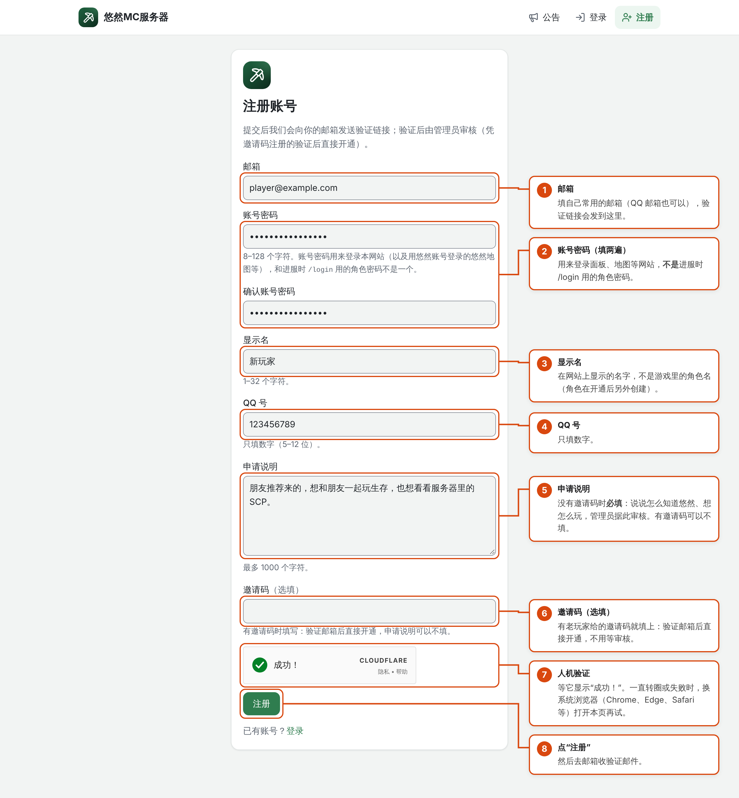
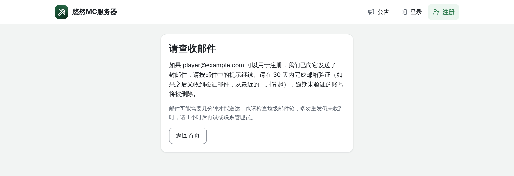
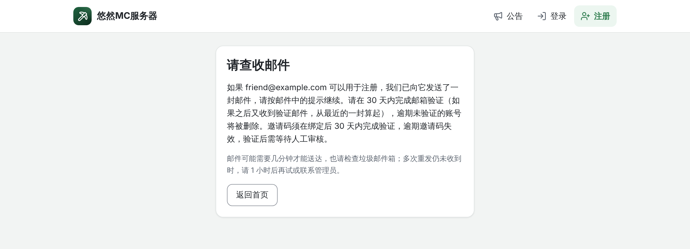
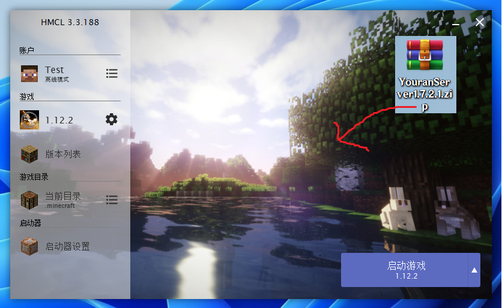
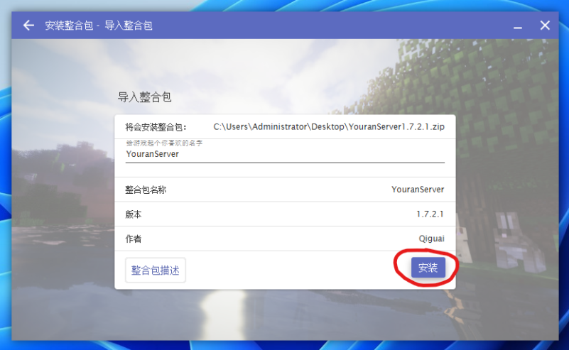
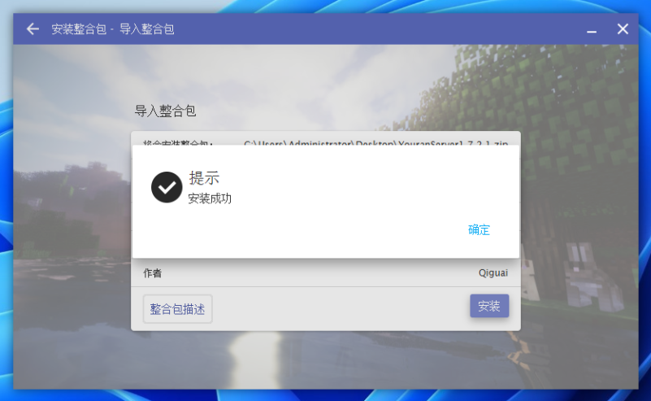
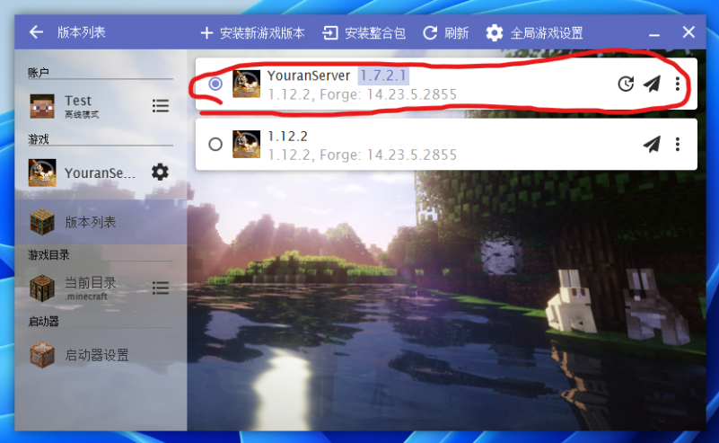

# 加入服务器

## 准备
如果想要游玩悠然服务器，请你先准备以下东西：

1. 一台电脑，推荐内存至少 8G，建议 16G 及以上，有独立显卡；
2. 一个可用于 Minecraft Java 1.12.2 (Forge) 的启动器，推荐使用 [HMCL（Hello Minecraft! Launcher）](https://hmcl.huangyuhui.net/)。PCL2（Plain Craft Launcher 2）、BakaXL 启动器也受支持，但无法获得诸如整合包自动更新的功能。不推荐使用未对中文社群生态做足够支持或已经停止维护的启动器，例如官方启动器、BMCL（Bangbang93 Minecraft Launcher）等。
请注意，若您打算使用非 HMCL 启动器，则在之后需要安装另外一种版本的整合包；
3. 一个浏览器，推荐使用 Microsoft Edge、Google Chrome 和 360 极速浏览器；
4. 一个良好的网络环境，推荐使用有线网络或通过 5G 频段与路由器进行通讯的 WLAN，如果有科学上网工具则更好，没有也没关系；
5. 一个可长期用于收发信件的个人电子邮箱，推荐使用 Gmail、QQ 邮箱和 163 邮箱。个人自建邮箱也受支持，但请注意其可用性要靠自己维护。

如果你有或可以准备以下东西，那会更好：

1. 一个正常的 QQ 账号；
2. 一个身份验证器，如 [Google Authenticator](https://play.google.com/store/apps/details?id=com.google.android.apps.authenticator2)、 [Microsoft Authenticator](https://www.microsoft.com/zh-cn/security/mobile-authenticator-app)、[Ente Auth](https://ente.com/auth/)等。

当这些东西都准备好后，就可以进入下一步了。

## 注册账号

悠然服务器通过悠然服务器网页面板（portal-youran.qingu.moe）来管理玩家，下文简称“网页面板”。你必须注册一个网页面板账号，完成邮箱验证并通过审核，才能进入悠然服务器。因此，你可以理解为，网页面板账号就是悠然服务器的通行证。除此之外，网页面板还承担着账号安全、权限管理、外部应用授权、公开状态查询等多种功能。例如，悠然地图（map.youran.qingu.moe）的账号就需要使用网页面板授权登录。

为了注册网页面板账号，请打开浏览器，并前往 [https://portal-youran.qingu.moe/register](https://portal-youran.qingu.moe/register)。你应当会看到一个注册界面，然后可按下图指引填写表单注册：

其中，若没有 QQ 号，可以随便填写一个占位数字，建议使用 10000。其他字段见上图说明。注册表单用的密码并不需要记住，因为之后需要重新设置。

提交注册表单后，若你未使用邀请码，则应当看到如下的界面：

如果有使用邀请码，则应当看到如下界面：

此时，网页面板会向你的邮箱发送一封邮件。请打开你的邮箱，找到这封验证邮件并打开其中的链接，按指引重新设置密码并确认注册信息，即可完成邮箱验证。

完成邮箱验证后，若你在注册时使用了正确且尚未被使用的邀请码，则可以跳过审核步骤。若在注册时未使用但你拥有可以使用的邀请码，也可以在注册完后，在等待审核界面使用邀请码跳过注册。否则，请等待账号审核完成。在等待期间，你可以同时准备我们服务器的客户端。

## 准备客户端

你可以通过三种方式下载我们服务器的客户端：

1. 更新服务器下载（推荐）
2. 微云网盘下载
3. 服务器QQ群下载（不推荐）

为什么上面不直接放下载地址呢？一方面这些地址你都可以在服务器官网上找到，另一方面这些地址经常变，在这里也放链接的话就很麻烦。

服务器官网如下：

- [https://youran.qingu.moe/](https://youran.qingu.moe/)
- [https://mirror.youranserver.top/](https://mirror.youranserver.top/) （备用，很快就要寿终正寝了，内容已经过时）

**基于你所想要使用的启动器不同，需要使用不同的整合包（客户端）格式**。对于 HMCL 启动器，两种格式都能接受，但推荐使用“**普通客户端**”，其背后基于 HMCL 的自动更新整合包功能，可以实现客户端自动升级，无需人工重复下载安装。对于 PCL 或其他启动器，请下载 **MCBBS 标准客户端**。相比前者，该客户端被众多启动器支持，但缺乏自动更新功能，因此你需要手动安装更新。另外，MCBBS 标准客户端实际上也是一个标准的 Curseforge 格式客户端，因此也能被许多境外启动器兼容。

### HMCL  启动器

对于 HMCL  启动器，你无需事先下载整合包文件。只需打开你的 HMCL 启动器，然后点击左侧的下载按钮：

接下来，切换到整合包安装界面：

然后，点击右侧的安装整合包：

之后，在界面中选择“从互联网下载整合包”：

在弹出的窗口中，填入`https://dl-yr.qg.mo.cn/server-manifest.json`，然后点击“确定”：

最后，点击“安装”即可自动下载安装：

你也可以在服务器官网的[整合包版本列表](https://youran.qingu.moe/list)页面手动下载压缩包，只需要选择“普通客户端”，点击那个巨大的下载按钮即可。然后将压缩包直接拖入HMCL界面中：

点击安装，启动器就会自动安装整合包。

不论哪种下载安装途径，不出意外的话，安装很快就会完成：

### Prism 启动器

你可以直接点击下方按钮自动跳转到 Prism 启动器并安装 MCBBS 标准整合包：

### Plain Craft Launcher 2 启动器（PCL2）

请先在服务器官网的[整合包版本列表](https://youran.qingu.moe/list)页面手动下载压缩包，需要切换成 MCBBS 标准客户端，然后点击下载按钮：

下载完成后，打开 PCL2 启动器，然后将整合包文件整体拖入界面中：

你应当看到如下界面，之后便会安装成功。请注意，在 PCL2 上安装的整合包无法自动更新，需要手动更新。

## 进入服务器

完成整合包的安装，**不代表你现在就能加入我们的服务器，你还要等待网页面板账号审核通过，并在通过之后创建你的游戏角色才可以进服。**

在网页面板账号（悠然账号）审核通过后，请前往[网页面板](https://portal-youran.qingu.moe)。你应该会看到如下界面。你需要点击“创建角色”按钮，来创建一个游戏角色。请注意，作为普通玩家，你每 24 小时最多创建 2 个游戏角色：

你应当会看到如下界面：

根据该界面的引导，**第一步**你需要确定你期望用于进服的游戏账户类型，这可以有三种选择：离线账户、正版账户和外置登录（俗称皮肤站）。该种选择只是作为一个角色创建引导，并不会限定你必须用指定的账户类型进服。

选定账户类型后，**第二步**需要填写你期望使用的游戏名。请注意，该游戏名**区分大小写**，且**不能使用特殊符号**，需要独一无二，但**可以使用中文**。如果你在第一步选择”正版账户“，还应当点击下方的”**向 Mojang 查询并填好**“按钮，该按钮会自动规范化你的游戏名字，避免因为细微的大小写区别导致无法进服。

**第三步**，你需要确定该游戏角色的进服验证方式。这里有一个容易产生误区的地方，我们服务器是**离线服务器**，不是正版服务器或基于皮肤站认证的服务器。我们的账号系统乍一看似乎很像皮肤站，但实际底层仍然是离线服务器。因此，我们需要通过各种方式确认以特定游戏名进服的玩家是否是拥有该角色的玩家。目前，服务器有四种验证方式：

1. 角色密码
2. OTP，严格来说是 TOTP 验证
3. 网页批准
4. **前置验证**

其中，除前置验证外，其余三种都可以在创建角色的时候选择。除网页批准外，其余三种验证方式都需要额外配置，即如下图的第四步。若你选择角色密码，需要创建一个与悠然账号密码不同的角色密码，该密码可用于角色进服验证。若你选择 OTP 验证，则需要在下一页面中绑定一个验证器，也就是在准备阶段可选准备的那些应用。若你选择网页批准，则无需配置，可直接创建游戏角色。验证方式可以在角色创建后自由调整。

完成创建后，该角色会进入“**待激活**”状态。你需要在**一周**内以该角色的身份进服以完成角色激活，否则该角色名会被**释放**，且你的角色创建额度不会被返还。完成激活后，你就正式加入了悠然服务器！成功激活的角色，即使长期不使用，也只会被**冻结**而不是**释放**。即使删除角色，角色名也不会被释放，而是会仍然保留，除非强制要求释放。但请注意，删除+恢复机制并非是用于突破你的角色上限的，一旦删除需要有一定冷静期才能恢复角色，因此请不要滥用该机制。

具体来说如何激活？你应当已经准备好了客户端。根据你之前配置的验证方式，选择合适的游戏账号启动游戏。对于 HMCL 客户端来说，游戏一启动就会自动进服。对于其他启动器，很有可能无法自动进服，需要你手动点击多人游戏列表，找到内置在整合包中的服务器，进入即可。进入后，你需要通过提前设置好的验证方式，完成登录验证，此时你的游戏角色就会被成功激活。这时候，你就正式加入了悠然服务器！欢迎！

### 前置验证

值得注意的是，对于拥有皮肤站/正版账号的玩家，前置验证是一个更方便且安全的验证方式，缺点就是前期配置比较复杂。因此我们推荐在一开始就配置好。

什么是前置验证？我们服是离线服务器，玩家只需要持有一个在白名单内的游戏名即可进服，服务器在进服前无从验证该玩家的身份，因此只能用事后的各种方式，如输入`/login <密码>`来验证身份。这种验证方式称为“**后置验证**”，因为其把验证的阶段放在了玩家进服之后。而这就意味着，一旦插件没有限制好，恶意者就有可能在未登录状态下绕过限制。同时，在一些场景下，例如玩家正处于紧张的 BOSS 战斗，后置验证由于需要在进服之后完成，有可能会影响玩家的战斗过程。

那为何正版服务器就不会有这种问题？因为正版服务器在玩家进服时，服务器会向玩家发起校验。具体来说，玩家进服时会告诉官方的验证服务器，让其知道这名玩家要进入哪个服务器。之后，服务器会向官方的验证服务器验证这名玩家是否正在进入该服务器。验证通过，就说明这名玩家的身份得到了确认，因为玩家要告诉官方的验证服务器正在进服，前提条件就是玩家拥有相应账号的凭证。除非游戏账号被盗，否则他人无法获得凭证以伪装身份。这就是“**前置验证**”，验证过程发生在玩家进服之前。它的好处相当明显，进服丝滑流畅，而且更重要的是这种验证建立的连接是加密连接，恶意者若验证不通过也无法获取世界状态哪怕一点信息。

悠然服务器虽然是离线服务器，但仍然实现了这一套“前置验证”机制。首先，每个游戏角色都可以绑定一个“外部账号”。因为悠然服务器支持各种验证服务器，包括 Mojang 官方和第三方皮肤站。绑定本质上就是让服务器知道你需要使用哪种验证服务器，且你拥有对应的账号。绑定完成之后，就可以将验证方式切换成“前置验证”。当服务器发现某个要进服的玩家名其进服验证方式是“前置验证”时，就会自动切换成上述相应的验证流程，建立安全的连接。需要注意的是，和真正的正版服务器不一样的是，我们服的“前置验证”仍然是绑定玩家名的，因此一旦外部账号玩家名发生变更，就无法以该账号通过前置验证，因为服务器不认识这个玩家名（游戏名）。

要使用前置验证，首先需要进行“外部账号绑定”。来到已经创建好的角色界面，找到“外部账号”：

点击后，你应当看到如下界面。根据你的外部账号平台，选择合适的验证服务器，然后填写你的账号密码，最后点击”开始绑定”：

接下来，你应当看到如下界面。根据界面提示，你需要在 10 分钟时间内，用完全符合角色游戏名的指定平台的游戏帐号启动客户端，并完成一次连接服务器操作。该连接不会真的进服，服务器会在验证成功/失败后自动断掉连接。因此，你甚至可以一边在服内游玩，一边开第二个客户端实例连接一次服完成验证。

完成验证后，界面上会显示进服的账号 UUID 以及皮肤信息。这时候，你可以将该皮肤设置为当前角色的头像。请注意，只有**正版账号**才能随时随地将角色皮肤设置为头像，皮肤站账号则需要角色在服内，或者在外部账号绑定确认的时候，才可以设置头像。最后，点击确认，就完成了外部账号绑定。

完成绑定不代表自动启用前置验证。你还需要回到角色页面，点击“进服验证”，然后选择“前置验证”（注意不要选择成两步验证的前置验证了），然后输入密码并确定即可。请注意该操作会强制下线当前游戏角色。

请注意，如果你的悠然账号启用了两步验证和“敏感操作也要第二步验证”，则上述所有需要输入密码的地方，都还需要进行两步验证。

## 更新客户端

对于使用 HMCL 的玩家，正常情况下，客户端会在启动时自动校验云端文件，并下载更新，因此无需手动更新客户端。若有特殊情况需要手动更新，则请点开客户端实例页面，在左下角找到“更新整合包”按钮，点击后，按**准备客户端**一节的内容安装即可。

对于使用非 HMCL 的玩家，尤其是 PCL2 玩家，则客户端无法自动更新。具体的客户端更新方法请自行查看相应启动器的文档。

你可以在客户端内安装额外的模组，即使是对于 HMCL 启动器而言，只要你不改动客户端现有文件或其文件名，就不会出现问题。自行添加的文件不会受自动更新影响。但如果你修改了现有文件或其文件名，则在自动更新过程中很有可能会出现配置被覆盖、重复模组加载崩溃等情况。如确有需求，请前往实例的根目录，找到并删除文件`modpack.cfg`即可，但请注意这会使 HMCL 客户端丧失自动更新功能。

## 游玩服务器

欢迎来到悠然服务器！
