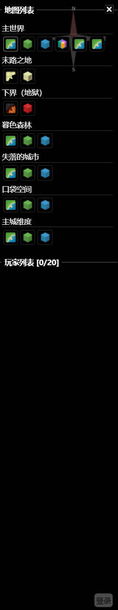
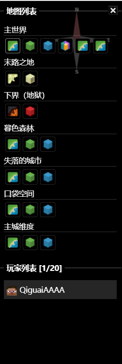
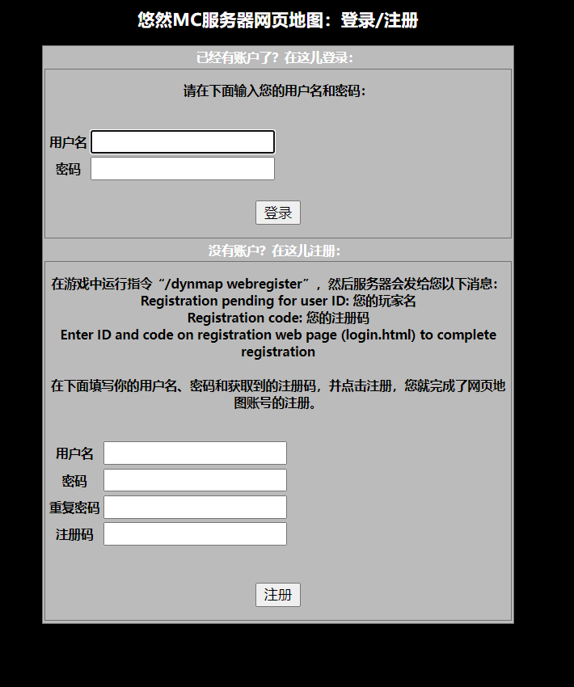
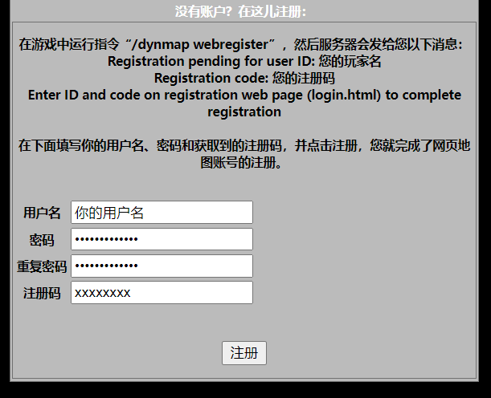

# 悠然地图

悠然地图是悠然服务器的网页地图，但无论从架构、功能、账号系统等方面来说，都像是一个平行于我们服务器的独立产品。和众多别的 Minecraft 服务器地图不同，悠然地图的设计参考对象是现实世界中的地理信息系统，更接近高德地图、Google Earth 这类产品的使用和编辑体验。悠然地图还给玩家提供**非公开要素**的记录和管理功能，每名玩家可以在一定额度限制内添加自己的非公开要素，从而在地图上留下你的记忆。你也可以向公众（公开）要素提交编辑建议，从而完善地图内容。

目前，悠然地图有三个站点：

- 主站（[https://map.youran.qingu.moe](https://map.youran.qingu.moe)）；
- 镜像站（[https://mirror.map.youran.qingu.moe](https://mirror.map.youran.qingu.moe)）；
- 经典版（[https://classic.map.youran.qingu.moe](https://classic.map.youran.qingu.moe)）。

其中，主站和镜像站的功能一致，经典版虽然也是服务器地图，但其界面和功能和悠然地图本体有不小差别。下文会细说。

之所以需要镜像站，是因为截止目前，主站的 IP 仍被大陆众多运营商封禁，因此特地搭建了镜像站以便利玩家访问。如若需要通过境外代理工具访问主站，建议仅将主机 map.youran.qingu.moe 添加到分流列表中，避免图块存储站点 tiles.map.youran.qingu.moe 以及其他本可以直连的站点走境外代理线路，消耗不必要的流量。

首先，我们先来看看悠然地图本体。你可以通过主站或镜像站任一能连接的站点进入。

## 界面

第一次进入悠然地图时，你应当会看到一个加载界面。网络通畅的情况下，几秒钟过后，你应当看到如下界面：

你会发现，悠然地图的界面和其他 Minecraft 地图的界面有显著区别，反而更像是高德地图或谷歌地图的界面。事实上也的确如此，悠然地图在开发过程中，其界面就是参考谷歌地图设计的。下图简要介绍了地图上的各元素：

进入地图，首先映入眼帘的就是明湖城附近地区，以及一种不像是 Minecraft 风格的底图。该底图就是“抽象图”。顾名思义，“抽象图”以分类着色的形式渲染地面上的方块，如黄色就是沙地，浅绿就是草地，灰白色就是硬化地面或石漠。除此之外，抽象图上还会显示棕色的等高线线条，以及深蓝色的等深线线条。通过右下角的图层面板，可以快捷切换到“卫星图”以及其他底图。“卫星图”就对应 Dynmap 的平面图视。除此之外，“斜视卫星图”就对应 Dynmap 的斜视图视。“分层图”和“分层卫星图”则是更高级的底图，后文会详细介绍。事实上，在这五种底图外，还有一种底图，就是“高程图”。该底图会在存在时自动加载以提供三维高程数据。不同纬度根据情况，可能只会启用一部分底图。例如主城纬度就没有两种分层底图，而口袋空间就只有分层底图。

底图上，可以看到叠加了各式各样的标记。悠然地图将这些东西称为“要素”，而不是“标记”。“要素”有四大种类：点、线、面、集合。每大种类根据画法不同，总共可以细分为 13 小类，分别是：

- 点：点状要素，只有一个节点
  - 贴地：节点可以没有高度，渲染高度使用当地的高程数据；
  - 准贴地：节点需要高度，但渲染高度使用当地的高程数据；
  - 真实高度：节点需要高度，且渲染使用节点高度数据；
- 线：线状要素，由多个节点按一定顺序从头到尾连接而成，可成环，可有向
  - 贴地：每个组成节点可以没有高度，渲染高度使用当地的高程数据；
  - 准贴地：每个组成节点需要高度，但渲染高度使用当地的高程数据；
  - 真实高度：每个组成节点需要高度，且渲染使用节点高度数据；
  - 过渡段：必须且只能由两个节点组成，一个节点可以没有高度，一个节点需要高度，渲染上前者节点采用当地高程数据，后者节点采用节点高度数据；
  - 高度范围：每个组成节点不需要高度，但整体需要宽度和高度范围数据，渲染成墙体；
- 面：面状要素，由多个节点按一定顺序从头到尾连接而成，必须成环
  - 贴地：每个组成节点可以没有高度，渲染高度使用当地的高程数据；
  - 准贴地：每个组成节点需要高度，但渲染高度使用当地的高程数据；
  - 真实高度：每个组成节点需要高度，且渲染使用节点高度数据；
  - 高度范围：每个组成节点不需要高度，但整体需要宽度和高度范围数据，渲染成长方体；
- 集合：无组成节点，由一个或多个其他要素组成

要素之间的节点可以共享，从而记录严格的拓扑关系，这有助于网络连通性分析。

打开左下角的“更多图层”菜单，你可以根据要素的一二级分类显示和隐藏部分或全部要素。你也可以开启或禁用地形修正，其本质也是一种特殊要素图层的开关。

在左上角的搜索框，你可以输入任意文字搜索相应的标记，支持拼音检索（未来会支持双拼）。搜索框左侧的汉堡菜单则可以打开侧面板，在这里可以调整地图界面样式、前往悠然服务器其他网页等。

右下角是功能菜单，在这里你可以点击按钮放大缩小地图；可以打开在线玩家列表并定位和跟踪玩家；可以打开测量工具测量距离或面积，查看沿途海拔高度变化。除此之外，还有一个按键帮助按钮，点击或将鼠标置于上方可以查看快捷键和手势操作指南。

右上角则是登录按钮，按钮左侧则显示着服务器当前的天气和游戏时间。

即使服务器处于关闭状态，你也可以自由浏览悠然地图，但请注意此时不会显示天气和游戏时间数据，也不会显示任何在线玩家（~~如果你确认服务器处于关闭状态，但看到了在线玩家，请\[数据删除\]~~）。

（下方内容为过时内容，待更新）

### 切换地图
网页地图不只是有主世界的俯视图。如果你把鼠标移动到右侧，就会打开侧栏。侧栏的样子如下：

在“地图列表”中，你可以自由切换不同维度的地图以及不同类型的地图。

为俯视地图，为斜视地图（即3D地图），为洞穴视图，为生物群系地图。

对于主世界右边多出来的两个地图，分别是温度地图和降水量地图。

### 追踪玩家

如果服务器有玩家在线，你就可以在侧栏的“玩家列表”中看到该玩家（如下图）。

玩家的名称如果像上图一样是白色，即说明玩家就在你目前选择的维度中。但如果显示的是这样的灰色，则说明该玩家在其他维度中，你可以通过点击玩家来跳转至该玩家所处的地方。

你也可以点击玩家的头像来跟踪该玩家。

### 注册/登录网页地图账号

如果你想要在网页地图上发言，我推荐你先注册一个网页地图账号，让别人知道正在网页地图上发言的人是谁。

点击网页地图右下角的“登录”按钮，你就会来到登录、注册界面：

注册一个网页账号，需要你提供账号用户名（即你的游戏名称）、账号密码和注册码。前两者我相信你知道是什么东西，这里唯一需要提到的就是注册码的获取。

首先你需要进入我们服务器，然后运行如下指令：`/dynmap webregister`。正常情况下，服务器会返回如下消息：

> Registration pending for user ID: 您的游戏名称
> 
> Registration code: xxxx-xxxx
> 
> Enter ID and code on registration web page (login.html) to complete registration

这串英文的意思是：

> 注册用户名: 您的游戏名称
> 
> 注册码: xxxx-xxxx
> 
> 在注册页面上输入您的注册用户名和注册码以完成账号注册。

随后你就需要在注册页面上填写你获取到的信息，如下图所示。

点击注册，你就完成了网页地图账号的注册！注意，请你最好将密码记下来或使用浏览器的密码箱保存帐户密码，密码一旦丢失不可找回！

